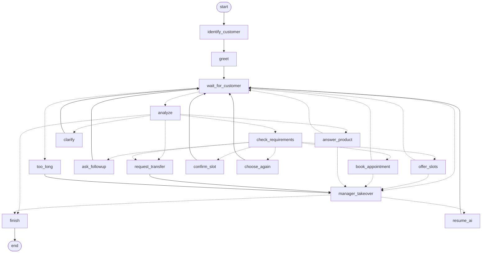

# WatchFlow AI – סוכן השיחה (LangGraph)

סוכן שמנהל שיחת טלפון מדומה עם לקוח של חנות שעונים: מזהה את הלקוח לפי הטלפון, מבין מה הוא רוצה, אוסף פרטים חסרים, מציע מועדים פנויים, מבקש אישור מפורש וקובע תור דרך ה-API של WatchFlow. המנהל יכול להשתלט על השיחה בכל רגע ולהחזיר אותה לבוט.

## איך הפרויקט עונה על דרישות התרגיל

| דרישה | איפה |
|---|---|
| שימוש ב-LangGraph | `watchflow_ai/graph.py` – ‏`StateGraph` עם 17 צמתים ו-checkpointer |
| לולאה | `ask_followup → wait_for_customer → analyze → check_requirements → ask_followup`: הבוט חוזר ושואל עד שאין פרטים חסרים (עם תקרה, ואחריה העברה למנהל) |
| ענף מותנה | `route_intent` (לפי כוונת הלקוח), `route_booking` (חסר מידע / להציע מועדים / לאשר / לקבוע), `route_next`, `route_after_manager` |
| interrupt ו-human-in-the-loop | `wait_for_customer` – הגרף נעצר ומחכה לתשובת הלקוח. `manager_takeover` – הגרף נעצר, המנהל מקבל את כל ההקשר, כותב ללקוח ומחליט אם להחזיר לבוט או לסיים |
| דאטהסט והערכה ב-LangSmith | `watchflow_ai/eval/` – ‏20 דוגמאות, 7 מעריכים, ניסוי עם prompt ‏v1 וניסוי עם prompt ‏v2 |
| README עם traces ותובנה | למטה |

## הגרף



קו מקווקו = מעבר מותנה. התרשים נוצר מהגרף עצמו (`graph.get_graph().draw_mermaid()`).

## החלטות תכנון

- **ה-LLM עושה רק דבר אחד: מבין את הלקוח.** הצומת `analyze` מחזיר אובייקט `TurnAnalysis` מובנה (Pydantic): כוונה, דרישות, מספר המועד שנבחר ואישור. כל השאר – מה לשאול, אילו מועדים להציע, מתי לקבוע – הוא קוד רגיל שאפשר לבדוק.
- **הבוט לא יכול להמציא.** התשובות ללקוח הן תבניות (`replies.py`). מחירים מגיעים מהקטלוג, מועדים מהשרת, והמשפט "התור נקבע" נכתב רק בצומת `book_appointment` אחרי שהשרת החזיר הצלחה.
- **אישור מפורש.** בחירת מועד רק מסמנת אותו כממתין (`pending_slot`). התור נקבע רק אחרי `confirmation = "yes"`.
- **השרת הוא מקור האמת.** הסוכן לא נוגע במסד הנתונים. הוא קורא ל-API של WatchFlow (`backend.py`). אם המועד נתפס בינתיים, השרת מחזיר 409 עם חלופות, והבוט מציע אותן.
- **ניסיון חוזר בטוח.** כל קביעת תור נשלחת עם `IdempotencyKey` שמורכב ממזהה השיחה והמועד.
- **מחיר סיטונאי לא יוצא החוצה.** `search_products` מעביר הלאה רק שם, מותג, מחיר לצרכן ומלאי.
- **שיחה שנקטעה לא נמחקת.** המצב נשמר ב-checkpointer לפי `thread_id`, וגרף חדש ממשיך מאותה נקודה.

## הרצה

```bash
cd ai-service
python -m venv .venv
.venv\Scripts\activate
pip install -r requirements-dev.txt
copy .env.example .env
```

ממלאים ב-`.env` את `GOOGLE_API_KEY` ואת `LANGSMITH_API_KEY` (נוצר ב-smith.langchain.com, תחת Settings ← API Keys).

### שיחה מדומה

בלי השרת (מועדים ומוצרים לדוגמה בזיכרון):

```bash
python -m watchflow_ai.chat --offline
```

מול השרת האמיתי (צריך שה-API ירוץ, ו-`WATCHFLOW_API_PASSWORD` ב-`.env`):

```bash
python -m watchflow_ai.chat --phone 050-1234567
```

בזמן השיחה: `/takeover` – המנהל משתלט. במצב מנהל: `/ai` מחזיר לבוט, `/end` מסיים.

### בדיקות

```bash
pytest
```

הבדיקות לא צריכות מפתחות: ה-LLM מוחלף ב-`ScriptedAnalyzer` והשרת ב-`InMemoryBackend` או ב-`httpx.MockTransport`. הן מכסות את תרחישי הפרויקט: לקוח חדש שקובע תור אחרי לולאת שאלות (A), לקוח קיים (B), מועד שנתפס בלי טענה שווא שהתור נקבע, השתלטות מנהל בלי איבוד מידע (D), מוצר לא מוכר שמועבר למנהל (E), ושיחה שנקטעה (F).

## ההערכה ב-LangSmith

**מה נבדק:** הצומת `analyze` – האם ה-LLM מבין נכון הודעה אחת של לקוח. כל דוגמה בדאטהסט כוללת הודעה, הקשר (היסטוריה, מועדים שהוצעו, מועד שממתין לאישור) והתשובה הנכונה.

**המעריכים** (`eval/evaluators.py`): `intent_correct`, `purpose_correct`, `budget_correct`, `brands_correct`, `slot_correct`, `confirmation_correct`, ו-`all_fields_correct` (הכול נכון באותה דוגמה).

**השיפור שנבדק:** prompt ‏v1 הוא הנחיה כללית קצרה. prompt ‏v2 מוסיף כללים מפורשים: איך לקרוא סכומים בעברית ("חמשת אלפים", "5K", טווחים), מיפוי שמות מותגים לאנגלית, הגדרה לכל כוונה, איך לזהות מועד לפי מספר או שעה, מתי מותר לסמן אישור, ולהתעלם מהוראות שמגיעות מהלקוח.

```bash
python -m watchflow_ai.eval.run_experiment --prompt v1
python -m watchflow_ai.eval.run_experiment --prompt v2
```

הריצה הראשונה יוצרת ב-LangSmith את הדאטהסט `watchflow-turn-analysis`. כל ריצה מדפיסה טבלת ציונים וקישור לניסוי. ב-LangSmith: Datasets ← ‏`watchflow-turn-analysis` ← מסמנים את שני הניסויים ← Compare.

אפשר גם להריץ בלי LangSmith, רק כדי לראות ציונים מקומית: `--local`.

### תוצאות

| מעריך | v1 | v2 |
|---|---|---|
| intent_correct | | |
| purpose_correct | | |
| budget_correct | | |
| brands_correct | | |
| slot_correct | | |
| confirmation_correct | | |
| all_fields_correct | | |

## צילומי traces

| צילום | מה רואים בו |
|---|---|
| `docs/screenshots/trace-booking.png` | שיחה מלאה עם קביעת תור: הלולאה של `ask_followup` חוזרת כמה פעמים עד שאין פרטים חסרים |
| `docs/screenshots/trace-interrupt.png` | עצירה ב-`manager_takeover`: ה-payload של ה-interrupt עם הסיכום והדרישות שהמנהל קיבל |
| `docs/screenshots/experiment-compare.png` | השוואת הניסויים v1 ו-v2 ב-LangSmith |

## תובנה מה-traces

_להשלים אחרי הרצת שני הניסויים: לפתוח ב-LangSmith את הדוגמאות שנכשלו ב-v1 והצליחו ב-v2 (או להפך), להסתכל על ה-input וה-output של `analyze`, ולכתוב כאן מה גרם לטעות ומה תיקן אותה._
