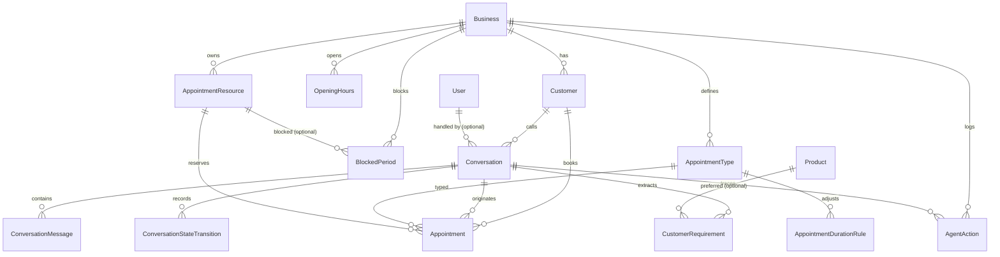

# WatchFlow AI – שלב 1: Domain ומסד נתונים

## ERD

הטבלאות הקיימות (Products, Orders, Stores, Users וכו') לא שונו.

## החלטות עיקריות

| נושא | החלטה | נימוק |
|---|---|---|
| מניעת חפיפה בתורים | Exclusion constraint ב-PostgreSQL על `tstzrange(ReservedStartUtc, ReservedEndUtc)` לכל משאב, רק לתורים בסטטוס `Booked` | בסיס הנתונים עצמו פוסל חפיפה, גם בשתי בקשות באותה מילישנייה. ה-LLM וה-Service לא צריכים "לזכור" לבדוק |
| זמני הכנה | נשמרים בתור כ-`ReservedStartUtc`/`ReservedEndUtc` | אינדקס לא יכול לחשב `StartUtc - interval` (פונקציה שאינה IMMUTABLE), לכן הטווח המלא נשמר במפורש ו-CHECK מוודא שהוא מכיל את התור |
| מודל קיבולת | כל `AppointmentResource` = קיבולת 1. קיבולת 2 = שני משאבים | exclusion constraint יודע לאכוף "אין חפיפה", לא "עד N חופפים". זה גם מודל מובן לעסק: מנהל, עמדה |
| משך תור דינמי | `AppointmentType` (בסיס + buffers) ו-`AppointmentDurationRule` (תוספת לפי סוג לקוח או הכנה מיוחדת) | הכללים במסד הנתונים, לא בקוד הסוכנים |
| דרישות לקוח | שורה לכל דרישה, עם `Certainty` (Confirmed/Inferred/Missing) וקישור להודעת המקור | מבחין בין מה שהלקוח אמר, מה שהוסק ומה שחסר, ברמת כל פריט |
| הפסקות | כמה חלונות `OpeningHours` באותו יום (09:00-13:00, 14:00-19:00) | הפסקה = הרווח בין חלונות, בלי טבלה נוספת |
| Enums | נשמרים כטקסט בטבלאות החדשות | קריא ב-DB, וה-constraint משתמש ב-`'Booked'` ולא במספר שעלול להשתנות |
| Audit | `AuditInterceptor` ממלא `CreatedAtUtc/CreatedBy/UpdatedAtUtc/UpdatedBy` | אף Service לא צריך לזכור. `CreatedBy` שהוגדר מראש (למשל שם סוכן) נשמר |
| Concurrency בשיחות | `Conversation.RowVersion` (xmin) ו-`MessageCount` | שני מנהלים שלוחצים "השתלטות" יחד: רק אחד מצליח. מספור הודעות בלי כפילויות |
| טלפונים | `PhoneNumber.TryNormalize` ל-E.164 | זיהוי לקוח לפי טלפון חייב פורמט אחד |
| כמה עסקים | `BusinessId` בטבלאות החדשות בלבד | הכנה להרחבה בלי לשבור את WatchStore |

## Migration

`WatchStore.Data/Migrations/20261117223112_AddWatchFlowDomain.cs` נוצר עם `dotnet ef`, ונוספו לו ידנית שתי שורות:
`migrationBuilder.Sql(AppointmentOverlapConstraint.CreateSql)` בסוף `Up` ו-`migrationBuilder.Sql(AppointmentOverlapConstraint.DropSql)` בתחילת `Down`,
כי EF לא יודע לייצר exclusion constraint בעצמו.

הרצה מקומית: `dotnet build` ואחריו `dotnet test`. העלאת השרת מחילה את ה-migration אוטומטית.

## CI

`.github/workflows/ci.yml` רץ בכל push ל-`main` ול-`watchflow-*`: build, בדיקות מול PostgreSQL 16, ובדיקה שה-migrations תואמים למודל.
התוצאות בטאב Actions, כולל טבלת סיכום של הבדיקות.

## סטטוס

| רכיב | מצב |
|---|---|
| Entities, Enums, Configurations, Repositories, Seed, Audit | מומש |
| Exclusion constraint | מומש, נבדק ב-SQL ובבדיקות xUnit ב-CI |
| Migration | נוצר (`AddWatchFlowDomain`) |
| בדיקות xUnit | רצות ב-GitHub Actions |
| DTOs ו-Endpoints | שלב 2, יחד עם ה-use cases |
| בדיקת שעות פעילות וחסימות בזמן הזמנה | שלב 2 (Scheduling engine) |
